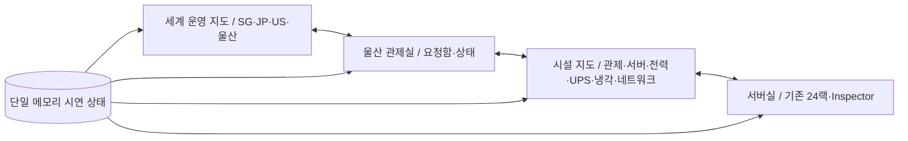

# Phase 0~2 설계 계약

모든 화면에 현재 위치 breadcrumb, 상위 공간 복귀, 동일 요청 ID·고객 ID·랙 ID, `시연 모드 · 가상 요청 데이터`를 표시합니다. 네비게이션·카메라·선택은 진행/시각/점수/자원을 바꾸지 않습니다. 별도 DB·브라우저 저장소도 사용하지 않습니다.

| 공간 | 필요한 데이터 | 주요 행동 | 복귀 |
| --- | --- | --- | --- |
| 세계 | 울산 위치, SG 요청 알림, JP/US 요청 없음, 가상 경로·링크 상태 | 국가 선택·SG 요청 확인·울산 진입 | 최상위 |
| 관제실 | 원래 조건·요청 단계·진행·장비/망·가상 자원 | 접수·상태 확인·시설 이동·결과 확인 | 세계 |
| 단지 | 시설 유형·상태·대상 서버동·랙 위치 | 시설 선택·초점·서버동 진입 | 관제실 |
| 서버실 | 기존 장비·가상 센서·같은 요청·관련 랙 | 기존 카메라·선택·시연 시작/진행/복구/확인 | 단지 |

## 상태·라우팅

- 전용 deterministic fixture: 요청 `SG-2026-001`, 고객 `SG-LINK-01`, 시설 `ULSAN-AIDC-01`, 서버동 `HALL-01`, 랙 `D-06`. 원래 요청 조건은 deep freeze하고 단계에 관계없이 동일하게 표시.
- `world-store.js`가 route/view selection과 request/facility domain을 보유. 모델은 DOM·Three·Python에 의존하지 않음. 잘못된 ID·순서·장소의 변경 요청은 거부하고 domain을 보존.
- 경로 `#world`, `#noc`, `#campus`, `#hall`은 검증된 allowlist. 상위 이동·breadcrumb·브라우저 뒤로 가기 지원. 새로고침 시 시연만 초기화.
- 화면 전환 때 geometry·texture·renderer를 재생성하지 않음. 기존 hall/NOC와 새 world/campus Group의 visibility·카메라만 전환. 시각 애니메이션 시간과 도메인 진행 시간을 분리.
- 명시적 흐름: SG 요청 확인 → 관제실 접수 → 서버동/랙 추적 → D-06에서 작업 시작(25%) → 진행(40% 업링크 장애) → 복구 시작 → 복구 처리 완료 → 사후 확인(60%) → 완료(100%) → 관제실 결과 확인.
- 복구 대기는 자동 타이머로 끝나지 않음. 모든 단계는 버튼 한 번으로 한 번만 진행하며 같은 요청 ID를 유지. 다른 나라의 업무·새 챕터·터미널·엔진 어댑터는 추가하지 않음.
- 기존 독립 시제품은 `lab.html`로 접근 가능하도록 원본 HTML/진입점을 보존하고 회귀 검사. 기본 `index.html`은 세계 탐색 화면.

## QA 표

| 단계 | 검증 |
| --- | --- |
| Phase 0 | 실제 로컬 브랜치·24랙 실행·보호 해시·참고 사진 분석·설계 |
| Phase 1 | 네 화면·상위 복귀/breadcrumb·잘못된 ID·카메라·상태 무변경 |
| Phase 2 | SG 동일 조건·ID·랙, 잘못된 단계 차단, 클릭만 진행, 장애/복구/사후 확인 동기화 |
| 최종 | 1920×1080 DPR1 실제 Chrome 입력·캡처·새 FPS/GPU/메모리·기존 실험실 회귀·반복 이동 자원 안정성·기존 Python diff·보호 해시 |

기존 Tkinter Preflight 전경 실패와 DPI별 실패는 별도 QA로 유지. 실제 Windows 배율 변경·물리 마우스 검사·사용자 Phase 3 직접 평가는 자동 브라우저 QA와 구분합니다.
