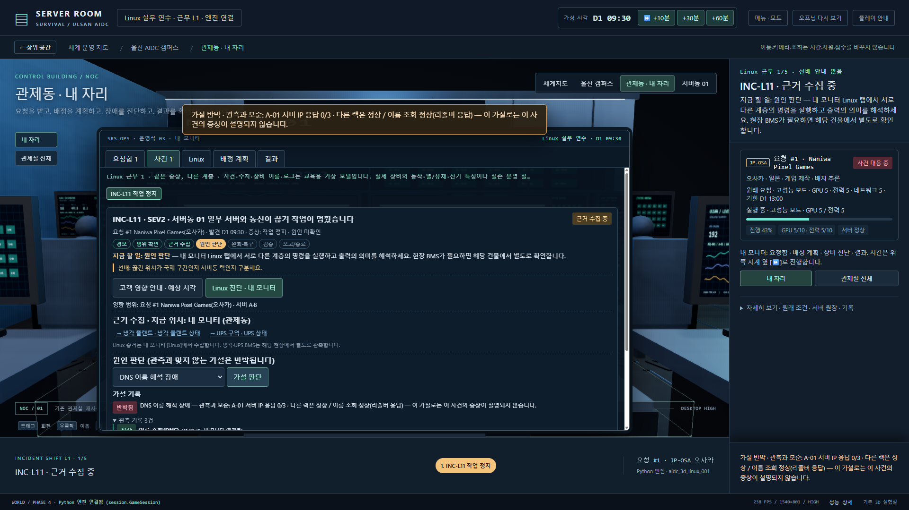
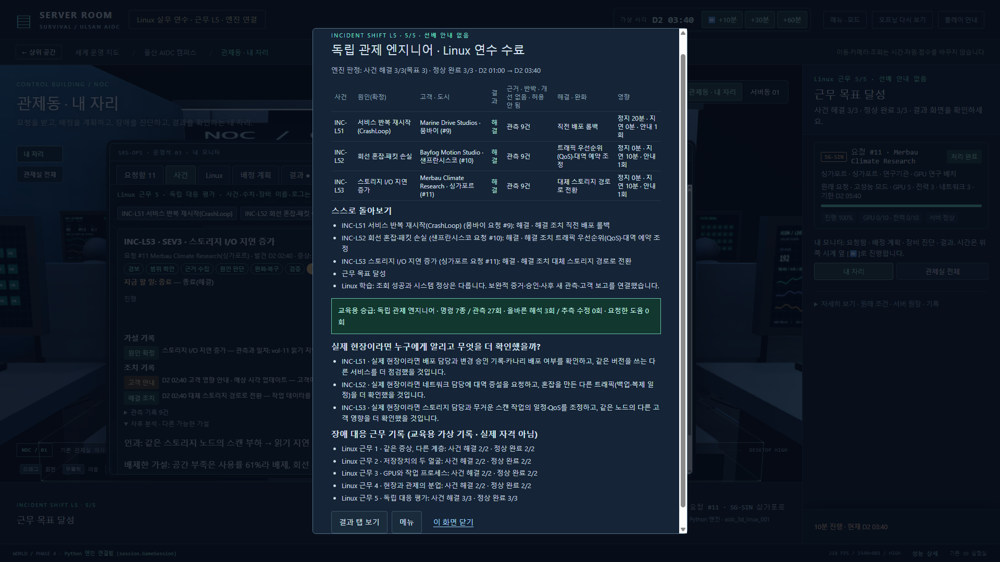
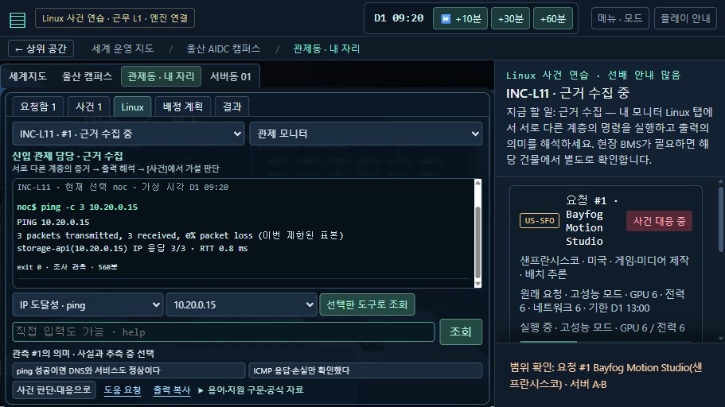

# Phase 8 QA — Linux 진단·유한 연수·독립 대응 (Issue #9)

작성: 2026-11-26. 기준 `287eba4fcc5078eb5815e0b6223f6985f18de8a2`, 작업 브랜치 `experiment/3d-linux-learning-phase8`. 구현은 [아키텍처와 사건별 학습표](PHASE8_ARCHITECTURE.md), 문법·채택 근거는 [공식 자료](PHASE8_REFERENCES.md), 리뷰 범위와 수정은 [독립 정적 리뷰](REVIEW_PHASE8.md)를 확인합니다.

## 실제 실행 결과

| 항목 | 결과 | 증거 |
| --- | --- | --- |
| Phase8 최종 Chrome 실제 UI | **12/12 PASS** | [final/phase8-qa.json](qa/phase8/final/phase8-qa.json) |
| 앞선 전체 UI 실행 | 11/11 PASS, 이후 리뷰 수정으로 최종 12개 재시험 | [full-attempt-1](qa/phase8/full-attempt-1/phase8-qa.json) |
| 신규 Python Linux 검사 | **95/95 PASS** (CLI·10종·5근무·저장·반례) | `tests.test_linux_cli`, `tests.test_linux_curriculum`; 최종 전체 로그에 포함 |
| 기존 Phase7 Chrome 회귀 | **12/12 PASS** | [regression-phase7/phase7-qa.json](qa/phase8/regression-phase7/phase7-qa.json) |
| 기존 Phase6 Chrome 회귀 | **16/16 PASS** | [regression-phase6/phase6-qa.json](qa/phase8/regression-phase6/phase6-qa.json) |
| 기존 Phase5 Chrome 회귀 | **9/9 PASS** | [regression-phase5/phase5-qa.json](qa/phase8/regression-phase5/phase5-qa.json) |
| Phase4·lab·Python 전체·adapter·JS·build | 최종 직렬 회귀 실행 중 | 완료 후 수치 확정 |
| Tk GUI 311개 | **미실행**, PASS 수에 포함하지 않음 | Issue/AGENTS 지침 |
| 기존 사용자 저장·과거 QA 보호 | **1,047개 변경 0** | [protection-result.json](qa/phase8/protection-result.json), [시작 해시](qa/phase8/protected-before.json) |

최종 Phase8 실행 시각: 16:04:30~16:13:50 KST. 설치된 Chrome의 headed 모드와 Playwright Core를 사용했습니다. 선행 제1~5장부터 실제 클릭·선택·타이핑으로 149초, Linux 정규 5근무를 305초에 완주했습니다. seed나 임의 POST/API로 진행·성공을 만들지 않았습니다. API는 실제 화면 이벤트가 호출하며 QA용 snapshot·SQLite 조회는 읽기 전용 검증입니다. 저장은 OS 임시 폴더, Phase8 포트는 엔진 8808/Vite 5208입니다.

## 실제 UI 조작으로 확인한 것

1. 수료 전 정규 Linux 연수 잠금, 이유 표시, 증상 이름의 10종 연습 진입. 제1~5장 실제 수료 뒤 정규 입장 해금.
2. 근무1 도구/대상 선택 → 근무2 옵션/대상 조립 → 근무3~5 장비 선택·직접 입력. 브리핑, 사건 범위, 명령 증거·해석, 원인 판단, 현장 승인/조치, 복구 후 **새 관측**, 검증과 고객 보고로 모든 근무 종료. 같은 근무에 사건이 겹쳐도 요청과 증거가 섞이지 않음.
3. 최종 독립 평가는 CrashLoop·혼잡·I/O 지연의 새 고객/일정 조합. 숨은 type을 읽지 않고 실제 출력(Pod·로그·핑·DNS·용량·I/O·경로)을 조사해 원인을 고름. 자동 선배 힌트 없이 3건 종료, Python 결과의 독립 관제 엔지니어 수료 확인.
4. 학습 중 진단 전, 냉각 복구 타이머 진행 중, 최종 수료의 **Python 프로세스 종료→재시작→페이지 재로드/이어하기**. `linux`, `incident`, 시계, 서버, 요청, 근무 결과가 전후 동일.
5. 잘못된 변경 명령, 잘못된 해석, 배정되지 않은 서버 접근이 증거/정답을 만들지 않음. 정상 IP ping과 DNS 실패를 구별. ToR에 DNS 가설 반박, DNS에 서비스 재시작 개선 없음·10분 잠금 확인.
6. Enter, 입력 240자 제한, 위/아래 히스토리, 출력 복사, 입력 포커스. 요청을 실제로 1초 지연시켜 입력·장비·사건 선택 잠금과 결과 후 복원 확인. `clear`는 현재 사건 화면만 숨기고 다른 사건 출력·엔진 증거를 유지.
7. Kubernetes 가상 업무에서 **28개 서로 다른 진단 호출**을 실제 컨트롤로 모두 실행. 전체 자동 로그에 93건의 유효 명령 실행을 기록했고 매번 CLI가 시간·작업·자원 원장을 바꾸지 않는지 비교.
8. UPS 연습에서 미대응 시간 초과로 실제 실패 → 새 슬롯 재도전. 원본 SQLite의 SHA-256이 바이트 단위로 동일하고 새 슬롯 ID가 다름.
9. 각 근무 결과를 읽기 전용 SQLite의 `simulation_state`와 비교: 원인·종료 상태·증거 개수·학습 결과·근무 클리어 일치. 5근무의 11사건(10유형, I/O 2회)이 모두 closed/resolved. 오류/콘솔 오류 0.

| 근무 | 사건 | 실제 대응 | 결과 |
| --- | --- | --- | --- |
| 1 | ToR, DNS | 네트워크동 업링크 우회, 리졸버 전환 | 2건 종료, 신입 |
| 2 | I/O 지연, 공간 소진 | 서버동 대체 경로, 허용된 게임 임시 파일 정리 | 2건 종료, 주니어 |
| 3 | CUDA OOM, GPU 장치 오류 | 고객 동의 후 배치 축소, 랙 격리·이전 | 2건 종료 |
| 4 | UPS, 냉각 | BMS·시설팀 호출·계획 중단, 승인 후 예비 펌프 요청 | 2건 종료, 운영 엔지니어 |
| 5 | CrashLoop, 혼잡, I/O 지연 | 플랫폼 승인 롤백, 네트워크 QoS, 스토리지 대체 경로 | 3건 종료, 독립 관제 엔지니어 |

## 화면·WebGL

- 1366×768/DPR1, 1920×1080/DPR1, 1280×720/DPR1.5, 911×512/DPR1.5에서 입력·조회·사건 복귀·노드 선택·터미널·사건 탭의 사각형과 `elementFromPoint`를 검사했습니다. 핵심 대상이 화면 안에 있고 다른 요소에 가려지지 않았습니다. 터미널 출력 자체는 스크롤합니다.
- 150%는 **Chrome CDP 배율 에뮬레이션**입니다. 각 경우 실제 `devicePixelRatio=1.5`도 확인했습니다. Windows 설정을 변경한 실제 OS 배율 QA라고 주장하지 않습니다. 앞선 `full-attempt-1`은 CSS viewport 축소만 했으므로 최종 결과를 기준으로 삼습니다.
- 움직임 줄이기 설정에서 세계→캠퍼스→서버동→관제를 6회 순환: FPS **236.8~237.6**, p95 **4.3ms**, geometries **536**, textures **84** 고정, JS heap 약 **34.9~56.4MiB**. 특정 시스템/장면의 표본이며 VRAM 또는 모든 장치의 성능 보장이 아닙니다.

## 단위·경계 검증

28개 명령 각각 유효 구문/잘못된 옵션·기대 종료 코드/내용 근거를 검사합니다. 셸 연결·파이프·치환·리다이렉션·quote·길이·경로/namespace 탈출·변경 명령·잘못된 자료형을 거절하고 사건 상태와 원장을 보존합니다. AST 검사로 실제 실행 모듈/함수 도입도 막습니다.

NSS 실패 2, SERVFAIL의 dig 종료 0, HTTP503의 curl 종료 0, 서비스 실패 3, 환경 없음/권한 거부를 구별합니다. 정상 GPU/무관한 IP의 관측은 다른 장치 장애의 증거로 인정하지 않으며 부모 증거와 CLI 사전/사후 요건 모두에서 제외합니다. 10종 각각 보완적 조회·해석·적절한 대응·사후 새 조회·보고를 검사합니다. 저장 실패 롤백, 지문 변경 거절, 오래된 token, 정답 키 미노출, 가설 후보별 대칭 검사, 기존 Chapter5 Lab 호환을 포함합니다.

독립 리뷰는 별도 에이전트에 전달한 실제 코드 본문의 정적 검토입니다. 해당 에이전트가 파일 도구나 실행 환경으로 전체 코드를 조사/테스트한 것은 아닙니다. 9건 지적과 추가 자체 점검을 수정하고 주 에이전트가 실행 검증했습니다.

## 개발 중 실패와 잔여 한계

- 초기 개발 E2E에서 Linux 메뉴 카드 누락을 발견해 수정했습니다. `qa/phase8/development*`에 실패/개발 검사를 보존하며 최종 PASS와 합산하지 않습니다. PowerShell의 `npm.ps1` 실행 정책 때문에 Node 직접 실행/`npm.cmd`를 사용했습니다.
- 실제 Linux 호환 셸 전체가 아닌 정해진 노드/경로/문법의 가상 교육 환경입니다. 실제 센서·패킷·로그 파일·GPU·클러스터에 접근하지 않습니다. BMS와 현장 승인은 별도 화면입니다. `dcgmi health --fetch` 대신 공식적으로 수동 관측 평가인 `--check`를 채택했습니다.
- **Issue #8 글로벌 자유 운영 seeded/random 장애는 여전히 미구현**이며 본 Phase에서 완료로 보고하거나 이슈를 닫지 않습니다. 기존 Tk GUI 311개와 실제 Windows 배율 변경 검사는 이번에 실행하지 않았습니다.
- 배포/호스팅·main 병합·PR 생성·강제 Push는 하지 않습니다. 새 의존성 추가 없음. 최종 커밋/원격 SHA는 Issue #9 완료 댓글에 기록합니다.

## 재실행

프로토타입 폴더에서 `npm.cmd run qa:phase8 -- --out=../../docs/3d-world-expansion/qa/phase8/<새이름>`을 실행합니다. 직렬 전체 회귀는 `npm.cmd run qa:phase8:regression`, 보호 비교는 `python scripts/protect_phase8.py after`입니다. QA helper는 엔진/Vite 두 포트를 먼저 검사하고 임시 저장 식별자를 확인하여 자기 서버만 사용합니다. 기존 QA 폴더를 덮어쓰지 않도록 Phase7에도 `--out=`을 추가했습니다. 정리 대상도 OS 임시 폴더의 `srs3d-qa-*` 경로 안으로 제한합니다.
