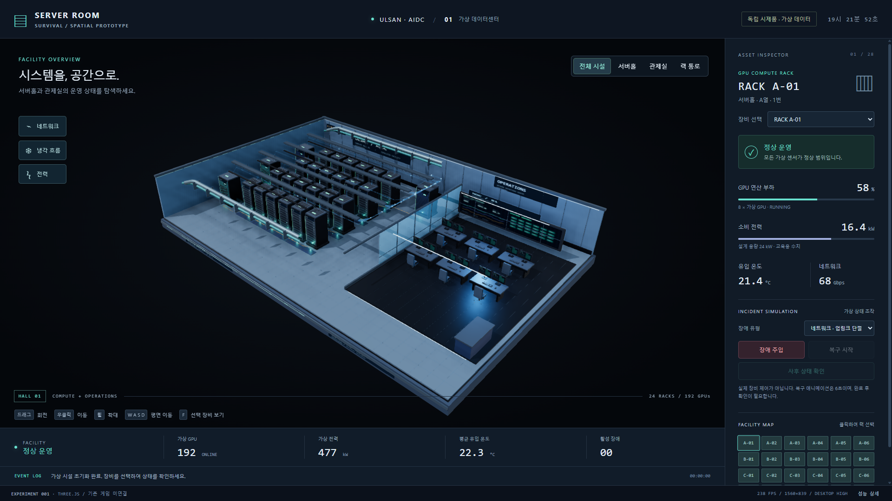

# 3D 데이터센터 시제품 001

서버실 생존기의 **독립 공간·그래픽 시제품**입니다. 기존 Python/Tkinter 게임, SQLite, 스토리 진행, 자원 원장과 연결하지 않습니다. 운영 값은 메모리 안의 가상 데이터이며 새로고침하면 초기화됩니다.



## 실행

Node.js와 npm이 설치된 Windows PowerShell에서:

```powershell
Set-Location C:\Users\hahye\Desktop\server-room-survival\prototypes\3d-datacenter-001
npm.cmd ci
npm.cmd run dev
```

브라우저에서 **http://127.0.0.1:5173/** 를 여세요. 종료는 서버를 실행한 터미널에서 `Ctrl+C`입니다. PowerShell의 `npm.ps1` 실행 정책을 바꾸지 않도록 `npm.cmd`를 사용합니다. 로컬 접속만 허용하며, 개발 서버의 파일 접근 허용 범위도 이 시제품 폴더로 제한했습니다.

빌드 결과 실행:

```powershell
npm.cmd run build
npm.cmd run preview
```

개발 서버와 preview는 같은 포트를 사용하므로 하나씩 실행합니다. `dist/`와 `node_modules/`는 Git에서 제외합니다.

## 구현 범위와 조작

- 랙 24대, 가상 GPU 192개, UPS/PDU·냉각기 2대·네트워크 코어. 랙 모듈·상부 케이블 트레이·냉각 배관·이중 급전 모식 경로·바닥 환기구를 배치했습니다.
- 유리 파티션으로 구분한 관제실, 대형 운영 모니터 월, 듀얼 모니터 운영 콘솔 6석. 모니터 월과 상세 패널은 같은 가상 시설 상태를 사용합니다.
- 마우스 왼쪽 드래그: 회전. 오른쪽 드래그: 평면 이동. 휠: 확대·축소. 3D 화면에 포커스가 있을 때 `W/A/S/D`: 평면 이동, `Q/E`: 높이 이동, `F`: 선택 장비 보기.
- 전체 시설 / 서버홀 / 관제실 / 랙 통로 시점. 네트워크·냉각·전력 표시를 각각 켜거나 끌 수 있습니다.
- 3D 장비 클릭, 상세 패널 선택 목록, 작은 배치도에서 장비를 선택합니다. 선택은 자원을 변경하지 않습니다.
- GPU 연산 부하·전력·유입 온도·네트워크 지표를 표시합니다. 모두 교육용 가상 수치로 실제 GPU 사용률과 구분합니다.
- **정상 → 장애 → 복구 중 → 사후 확인 대기 → 확인 완료**. 장애 주입과 복구는 선택 장비에만 적용합니다. 복구 6초 동안 영향 지표가 유지되고, 완료 후 별도 [사후 상태 확인]을 눌러야 확인 완료로 바뀝니다. 배경 탭에서는 가상 시계를 멈춥니다.
- 업링크 단절: 네트워크 흐름 중지·연산 유휴. 전력 중단: GPU·네트워크·전력 0 및 LED 소등. 냉각 저하: 온도 상승·연산 제한 및 해당 랙 인근 공기 흐름 경고. 실제 설비의 장애 전파나 물리 계산을 재현한 모델은 아닙니다.

충돌 판정·실제 케이블/IP 토폴로지·CFD·전기 설계·터미널·학습 평가·저장·기존 게임 통합은 구현 범위가 아닙니다. 카메라는 벽과 장비를 통과할 수 있습니다. 세부 모델은 외부 모델 파일 없이 직접 만든 절차적 지오메트리·Canvas 텍스처입니다.

## 렌더링과 성능

RTX 5070 데스크톱을 목표로 고정한 Desktop High 설정: PBR 금속 재질, 환경 반사, 2048² 소프트 그림자, SSAO, bloom, FXAA, DPR 최대 2. 프레임에 따른 자동 품질 하향은 없습니다. 반복 부품·환기구·바닥·랙 LED는 인스턴싱하며 재질과 지오메트리를 공유합니다. 후처리를 포함한 전체 draw call을 계측합니다.

하단 [성능 상세]에서 FPS·p95 프레임 시간·비동기 GPU 타이머·JS heap·draw call·지오메트리/텍스처 개수를 확인합니다. JS heap은 브라우저 전체 메모리나 VRAM이 아닙니다. GPU 사용률·VRAM·브라우저 프로세스 메모리는 QA 스크립트가 별도로 기록합니다.

실제 실행 결과와 제한은 [QA 보고서](qa/report.md)를 확인하세요. GPU 자원 사용량은 다른 앱을 포함한 시스템 전체 NVIDIA-SMI 표본이므로 시제품 단독 점유로 해석하지 않습니다.

## 검증

```powershell
npm.cmd test
npm.cmd run build
# dev 또는 preview 서버 실행 중, 설치된 Chrome을 별도 임시 프로필로 실행
npm.cmd run qa
# 기존 게임·사용자 DB·과거 QA 파일의 해시 비교 (SQLite 연결 없음)
& 'C:\Users\hahye\anaconda3\python.exe' scripts/protect.py after
```

브라우저 QA는 Playwright Core와 기존 Chrome을 사용하며 브라우저를 다운로드하지 않습니다. 기본은 실제 창을 여는 headed 실행이고, 브라우저 프로필은 자동으로 격리·정리합니다. 상태 변경은 실제 UI 이벤트로만 수행하며 `window.prototypeQA`는 상태 복사본과 투영 좌표를 읽는 QA용 인터페이스입니다.

기준 환경: Node.js 26.13.1 / npm 11.20.0, Three.js 0.180.0, Vite 7.3.8. `package-lock.json`으로 설치 버전을 고정합니다.

## 보존과 통합 전 QA

- 실험 브랜치: `experiment/3d-datacenter-prototype-001`. 시작 기준 커밋 `4de7bb2`와 `docs/qa/desktop-start-2026-11-20/` 기록을 유지합니다.
- 기존 게임 코드·테스트·SQLite·저장 파일·DPI 설정을 수정하지 않습니다. 보호 기준선은 기존 파일의 크기와 SHA-256만 읽습니다.
- **기존 GUI Preflight 전경 확보 문제는 미해결 별도 QA 항목입니다.** 이번 브라우저 성공이 Tkinter 전체 회귀 성공을 뜻하지 않습니다. 기존 게임과 통합하기 전에 실제 대화형 데스크톱에서 해결·재검증해야 합니다. 코드나 테스트 기대값을 우회 수정하지 않았습니다.
- 기존 게임 통합·추가 개발 단계·main 병합·원격 배포는 이번 작업에 포함하지 않습니다.

기술 참고: [Three.js 공식 문서](https://threejs.org/docs/), [OrbitControls](https://threejs.org/docs/pages/OrbitControls.html). 데이터센터 장비 구성의 참고: [NVIDIA DGX SuperPOD 개요](https://www.nvidia.com/en-us/data-center/dgx-superpod/). 특정 실물 시설의 도면이나 실제 규격을 복제한 설계는 아닙니다.
