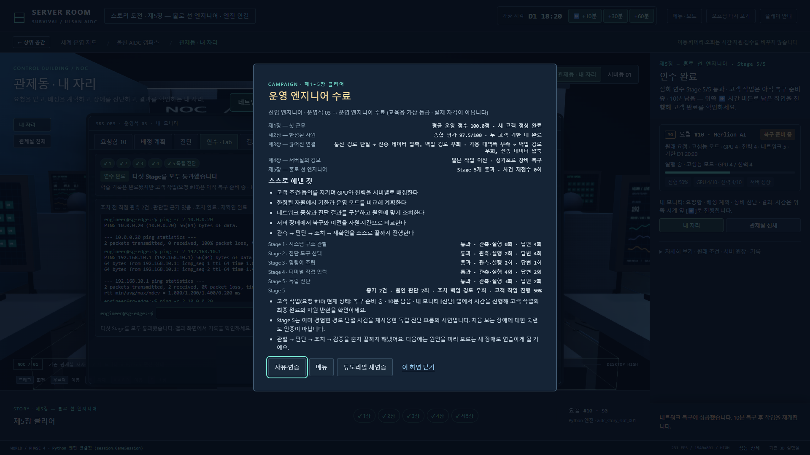

# 3D 데이터센터 — 서버실 생존기 3D (Phase 6)

서버실 생존기의 3D 화면입니다. **Phase 4(Issue #5)부터 기존 Python 게임 엔진(`session.GameSession`)과 연결**되어, 가상 시간·GPU/전력 원장·서버 배정·고객 조건/동의·기한·점수·서버 장애/복구를 모두 Python 엔진이 계산합니다. 3D 화면은 규칙을 복제하지 않고 엔진 결과를 보여 주며, 플레이어의 실제 조작을 엔진 행동으로 보냅니다. 구조는 [Phase 4 아키텍처](../../docs/3d-world-expansion/PHASE4_ARCHITECTURE.md), **[Phase 5 아키텍처 — 스토리 1~5장](../../docs/3d-world-expansion/PHASE5_ARCHITECTURE.md)**, **[Phase 6 아키텍처 — 글로벌 고객·교대 근무](../../docs/3d-world-expansion/PHASE6_ARCHITECTURE.md)**를 보세요.



## 실행 (엔진 + 3D)

Node.js·npm과 Python 3.10 이상(표준 라이브러리만 사용)이 필요합니다. Windows PowerShell에서:

```powershell
Set-Location C:\Users\hahye\Desktop\server-room-survival\prototypes\3d-datacenter-001
npm.cmd ci
$env:SRS_PYTHON = 'C:\Users\hahye\anaconda3\python.exe'   # PATH의 python을 쓰면 생략
npm.cmd run play
```

`npm run play`가 Python 엔진(127.0.0.1:8765)과 Vite(127.0.0.1:5173)를 함께 띄웁니다. 브라우저에서 **http://127.0.0.1:5173/** 를 여세요. 종료는 같은 터미널에서 `Ctrl+C`입니다(둘 다 종료). 5173 포트를 이미 다른 Vite가 쓰고 있으면 그 터미널을 먼저 종료하세요.

- 처음에는 **중립 세계 통신망 오프닝**(도착한 요청 없음 → 울산 → 캠퍼스 → 내 자리)이 한 번 재생되고, 끝나면 **모드 메뉴**가 열립니다: 튜토리얼 / 스토리 도전(제1장 — 첫 근무) / 자유·연습. 각각 [새로 시작]과 [이어하기]가 있습니다.
- **튜토리얼:** 선배가 지금 할 일·이유·위치를 알려 주고 **실제 컨트롤**(화면 요소의 금색 테두리 또는 3D 링)을 가리킵니다. 대신 눌러 주는 버튼은 없습니다. 캠퍼스 둘러보기 → 요청 확인 → 배정 결정 → 현장 시작 → 장애 대응 → 검증·보고(6목표·18단계). 끝나면 [스토리 도전 시작]으로 새 본편 저장이 시작됩니다.
- **스토리 도전 (Phase 5):** 한 저장에서 제1장 첫 근무 → 제2장 한정된 자원(일본·미국 동시 요청) → 제3장 끊어진 연결(경로 단절·대역폭 부족 진단과 조치) → 제4장 서버실의 경보(장비 복구 vs 작업 이전) → 제5장 홀로 선 엔지니어(Engineering Lab Stage 1~5, 가상 터미널)로 이어집니다. 장 클리어·실패는 엔진이 판정하고, 결과 화면에서 [다음 장 시작] / [현재 장 재도전 (새 슬롯)] / 메뉴를 고릅니다. 5장을 모두 클리어하면 **운영 엔지니어 수료**(교육용 가상 등급) 화면이 나옵니다. 메뉴의 "장 선택"은 기록의 장 시작 지점을 새 슬롯으로 시작합니다.
- **글로벌 운영 (Phase 6):** 제1~5장을 클리어한 정규 스토리 저장이 있으면 **글로벌 교대 근무**(교대 1 입문 → 교대 2 혼잡·경합 → 교대 3 독립, 서로 다른 가상 고객 17곳)가 열립니다. 세계 21개 도시·13개국·32개 가상 고객·9개 AI 업무 유형은 Python 엔진과 같은 카탈로그(`aidc/global_ops/catalog_v1.json`)에서 옵니다. **글로벌 자유 운영**은 언제든(진급 기록 없음) 연습할 수 있습니다. 세계지도에서 불이 들어온 도시나 배지를 누르면 그 요청이 선택됩니다.
- **자유·연습:** 엔진의 자유 운영 규칙(시간 기반 접수, 확률적 네트워크 장애) 그대로. **장 연습**(제2~5장)은 진급 기록이 남지 않는 별도 연습 저장입니다.
- 조작: 요청은 **관제동 · 내 자리의 내 모니터**(요청함 / 배정 계획 / 진단 / 결과, 제5장은 연수 · Lab 탭 추가)에서, 작업 시작과 사후 확인은 **서버동 01의 엔진 서버 랙 A-01~D-01**(Server A~D)에서, 시간은 위쪽 시계 옆 [⏩ +10분 / +30분 / +60분]으로 합니다. 나머지 20개 랙은 장식입니다.
- 저장은 `prototypes/3d-datacenter-001/saves/`(Git 제외, `SRS3D_SAVE_DIR`로 변경 가능)에만 새 파일로 만듭니다. 기존 Python 게임 저장(`aidc_game.db`, `aidc_story_slot_*.db`)은 열지 않습니다.
- `http://127.0.0.1:5173/lab.html` — **기존 독립 서버실 실험실**(엔진 미연결, 아래 설명)을 그대로 보존한 화면입니다.

엔진만 실행: `python -m engine.server [--port 8765] [--save-dir 경로]`. 엔진이 꺼져 있으면 3D 공간은 볼 수 있지만 게임은 시작되지 않고, 메뉴에 실행 방법이 표시됩니다.

이전 Phase 0~3.2의 '오른쪽 아래 큰 버튼 하나로 진행하는 시연'과 그 전용 규칙(`demo-actions.js`, `guide.js`)은 Phase 4에서 폐기했습니다.

빌드 결과 실행:

```powershell
npm.cmd run build
npm.cmd run preview
```

개발 서버와 preview는 같은 포트를 사용하므로 하나씩 실행합니다. `dist/`와 `node_modules/`는 Git에서 제외합니다.

## 기존 실험실(lab.html)의 구현 범위와 조작

- 랙 24대, 가상 GPU 192개, UPS/PDU·냉각기 2대·네트워크 코어. 랙 모듈·상부 케이블 트레이·냉각 배관·이중 급전 모식 경로·바닥 환기구를 배치했습니다.
- 유리 파티션으로 구분한 관제실, 대형 운영 모니터 월, 듀얼 모니터 운영 콘솔 6석. 모니터 월과 상세 패널은 같은 가상 시설 상태를 사용합니다.
- 마우스 왼쪽 드래그: 회전. 오른쪽 드래그: 평면 이동. 휠: 확대·축소. 3D 화면에 포커스가 있을 때 `W/A/S/D`: 평면 이동, `Q/E`: 높이 이동, `F`: 선택 장비 보기.
- 전체 시설 / 서버홀 / 관제실 / 랙 통로 시점. 네트워크·냉각·전력 표시를 각각 켜거나 끌 수 있습니다.
- 3D 장비 클릭, 상세 패널 선택 목록, 작은 배치도에서 장비를 선택합니다. 선택은 자원을 변경하지 않습니다.
- GPU 연산 부하·전력·유입 온도·네트워크 지표를 표시합니다. 모두 교육용 가상 수치로 실제 GPU 사용률과 구분합니다.
- **정상 → 장애 → 복구 중 → 사후 확인 대기 → 확인 완료**. 장애 주입과 복구는 선택 장비에만 적용합니다. 복구 6초 동안 영향 지표가 유지되고, 완료 후 별도 [사후 상태 확인]을 눌러야 확인 완료로 바뀝니다. 배경 탭에서는 가상 시계를 멈춥니다.
- 업링크 단절: 네트워크 흐름 중지·연산 유휴. 전력 중단: GPU·네트워크·전력 0 및 LED 소등. 냉각 저하: 온도 상승·연산 제한 및 해당 랙 인근 공기 흐름 경고. 실제 설비의 장애 전파나 물리 계산을 재현한 모델은 아닙니다.

(실험실 기준) 충돌 판정·실제 케이블/IP 토폴로지·CFD·전기 설계·터미널·학습 평가·저장·기존 게임 통합은 구현 범위가 아닙니다. 카메라는 벽과 장비를 통과할 수 있습니다. 세부 모델은 외부 모델 파일 없이 직접 만든 절차적 지오메트리·Canvas 텍스처입니다.

## 렌더링과 성능

RTX 5070 데스크톱을 목표로 고정한 Desktop High 설정: PBR 금속 재질, 환경 반사, 2048² 소프트 그림자, SSAO, bloom, FXAA, DPR 최대 2. 프레임에 따른 자동 품질 하향은 없습니다. 반복 부품·환기구·바닥·랙 LED는 인스턴싱하며 재질과 지오메트리를 공유합니다. 후처리를 포함한 전체 draw call을 계측합니다.

하단 [성능 상세]에서 FPS·p95 프레임 시간·비동기 GPU 타이머·JS heap·draw call·지오메트리/텍스처 개수를 확인합니다. JS heap은 브라우저 전체 메모리나 VRAM이 아닙니다. GPU 사용률·VRAM·브라우저 프로세스 메모리는 QA 스크립트가 별도로 기록합니다.

실제 실행 결과와 제한은 [QA 보고서](qa/report.md)를 확인하세요. GPU 자원 사용량은 다른 앱을 포함한 시스템 전체 NVIDIA-SMI 표본이므로 시제품 단독 점유로 해석하지 않습니다.

## 검증

```powershell
npm.cmd test              # JS 단위 (실제 엔진 스냅샷 fixture: python -m engine.tests.make_fixtures)
npm.cmd run test:engine   # 엔진 어댑터 (임시 저장 폴더만 사용)
npm.cmd run build
npm.cmd run qa:phase6     # 브라우저 QA: 제1~5장 실제 UI 수료 → 글로벌 교대 1~3 실제 UI 완주·실패/재도전·자유 운영·레이아웃·자원 → qa/phase6/
npm.cmd run qa:phase5     # 브라우저 QA: 제1~5장 실제 UI 완주·장마다 엔진 재시작/이어하기·실패/재도전·연습·레이아웃 → qa/phase5/
npm.cmd run qa:phase4 -- --out=../../docs/3d-world-expansion/qa/phase5/phase4-regression   # Phase 4 회귀 (기록 보존)
npm.cmd run qa:lab        # 기존 실험실(lab.html) 회귀 (dev 서버 실행 중)
# 기존 게임·사용자 DB·과거 QA 파일의 해시 비교 (SQLite 연결 없음)
& 'C:\Users\hahye\anaconda3\python.exe' ..\..\docs\3d-world-expansion\protect.py after phase5
```

Phase 6 결과: [QA_REPORT_PHASE6.md](../../docs/3d-world-expansion/QA_REPORT_PHASE6.md) · 보호 비교: `python scripts/protect_phase6.py after`(사용자 데이터 변경 0 / 원본 소스 변경 목록 분리). Phase 5 결과: [QA_REPORT_PHASE5.md](../../docs/3d-world-expansion/QA_REPORT_PHASE5.md). Phase 4 결과: [QA_REPORT_PHASE4.md](../../docs/3d-world-expansion/QA_REPORT_PHASE4.md). 이전 Phase의 `qa`/`qa:ux`/`qa:ux32` 스크립트는 폐기한 큰 버튼 시연을 조작하던 것이라 삭제했고, 유효한 검사는 `qa:phase4`로 옮겼습니다.

브라우저 QA는 Playwright Core와 기존 Chrome을 사용하며 브라우저를 다운로드하지 않습니다. 기본은 실제 창을 여는 headed 실행이고, 브라우저 프로필은 자동으로 격리·정리합니다. 상태 변경은 실제 UI 이벤트로만 수행하며 `window.prototypeQA`는 상태 복사본과 투영 좌표를 읽는 QA용 인터페이스입니다.

기준 환경: Node.js 26.13.1 / npm 11.20.0, Three.js 0.180.0, Vite 7.3.8. `package-lock.json`으로 설치 버전을 고정합니다.

## 보존과 QA 기록 (Phase 0~3.2 시제품 단계)

- 실험 브랜치: `experiment/3d-datacenter-prototype-001`. 시작 기준 커밋 `4de7bb2`와 `docs/qa/desktop-start-2026-11-20/` 기록을 유지합니다.
- 기존 게임 코드·테스트·SQLite·저장 파일·DPI 설정을 수정하지 않습니다. 보호 기준선은 기존 파일의 크기와 SHA-256만 읽습니다.
- **기존 GUI Preflight 전경 확보 문제는 미해결 별도 QA 항목입니다.** 이번 브라우저 성공이 Tkinter 전체 회귀 성공을 뜻하지 않습니다. 기존 게임과 통합하기 전에 실제 대화형 데스크톱에서 해결·재검증해야 합니다. 코드나 테스트 기대값을 우회 수정하지 않았습니다.
- Phase 3.2까지는 기존 게임 통합을 하지 않았습니다. Phase 4부터 엔진 어댑터로 연결합니다(위 실행 절). main 병합·원격 배포는 하지 않습니다.

기술 참고: [Three.js 공식 문서](https://threejs.org/docs/), [OrbitControls](https://threejs.org/docs/pages/OrbitControls.html). 데이터센터 장비 구성의 참고: [NVIDIA DGX SuperPOD 개요](https://www.nvidia.com/en-us/data-center/dgx-superpod/). 특정 실물 시설의 도면이나 실제 규격을 복제한 설계는 아닙니다.
