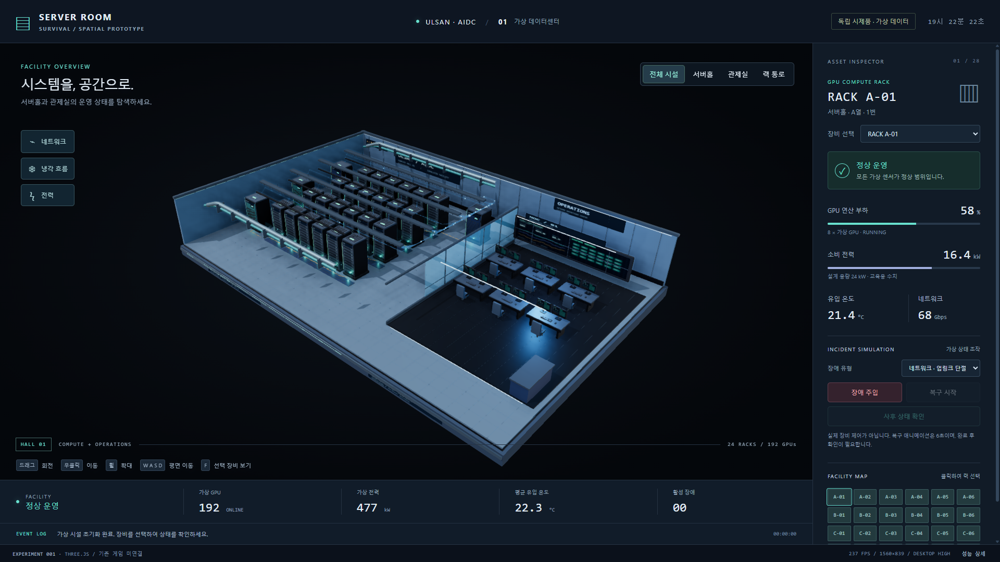

# 독립 3D 데이터센터 시제품 001 — 실제 실행 QA

검증일: **2026-11-20 (KST)**. 판정: **독립 시제품 실행·조작 QA 통과**. 기존 게임 통합 승인이나 기존 Tk GUI 전체 회귀 통과를 뜻하지 않습니다.

## 결과

`prototypes/3d-datacenter-001/`에 Three.js 서버홀·관제실을 구현했습니다. 가상 랙 24대와 기반 설비 4대, GPU·전력·온도·네트워크 상세, 카메라 자유 조작, 장비 선택, 원인별 장애·복구·사후 확인이 동작합니다. 게임 엔진·DB·사용자 저장과 연결하지 않습니다.

| 검사 | 결과 / 증거 |
| --- | --- |
| Node.js / npm | `v26.13.1` / `11.20.0`. `C:\Program Files\nodejs` 설치 도구. `npm.ps1`은 PowerShell 실행 정책으로 차단되어 `npm.cmd` 사용. 정책 변경 없음 |
| 시작 Git | `experiment/3d-datacenter-prototype-001`, HEAD `4de7bb2`, 기존 작업 트리 깨끗함. 원래 점검 커밋·기록 보존 |
| 상태 모델 | `npm.cmd test`: **6 PASS / 0 FAIL**. 세 원인별 복구·확인 순서, 동시 장애 격리, 잘못된 입력, 다른 장비 불변성 |
| 개발 빌드 | `npm.cmd run build`: 성공. Three.js 코어 청크 약 511kB의 크기 안내 1건. gzip 약 129kB. 빌드 오류 아님 |
| 실제 Chrome UI | **15 PASS / 0 FAIL**. [browser-qa.json](browser-qa.json) |
| 빌드 결과 실행 | **3 PASS / 0 FAIL**, Vite preview `127.0.0.1:5174`, Chrome headed. [production-smoke.json](production-smoke.json) |
| 브라우저 오류 | 최종 UI QA·빌드 smoke에서 runtime error / console error / failed request **0** |
| 의존성 검사 | Vite 7.3.8로 보안 수정 고정 후 `npm audit`: **취약점 0**. [npm-audit.json](npm-audit.json) |
| 보호 검증 | 기존 파일 **717개** 전부 파일 목록·크기·SHA-256 동일. [protection-result.json](protection-result.json) |
| 기존 사용자 보호 기준선 | 사용자 DB·잠금 **53개**, 이전 QA **508개**, 모두 `4de7bb2`에 보존한 원래 해시와 동일 |

설치 시 샌드박스의 npm 네트워크·캐시 접근이 거부되어 필요한 의존성 설치만 권한 확장 실행했습니다. 시스템 Node/npm·Python 패키지를 변경하거나 브라우저를 새로 설치하지 않았습니다.

## 실제 브라우저 실행과 입력

- 기존 설치 **Chrome 157.0.8103.80**을 `headless: false`로 실행했습니다. 사용자 기본 프로필 대신 자동 생성·정리하는 별도 임시 프로필을 사용했습니다.
- 실제 렌더러: `ANGLE (NVIDIA, NVIDIA GeForce RTX 5070 (0x00002F04) Direct3D11 vs_5_0 ps_5_0, D3D11)`. WebGL 2 및 GPU compositing enabled. GPU 강제 활성화·소프트웨어 대체 플래그 없음.
- 브라우저 뷰포트 **1920×1080**, DPR **1**, 실제 3D 렌더 캔버스 **1560×839**. 아래 캡처는 실제 브라우저 콘텐츠 캡처이며 목업 이미지가 아닙니다.
- Playwright/CDP의 실제 마우스·휠·키보드·select 이벤트로 조작했습니다. 랙 3D 좌표는 읽기 전용 투영 함수로 구하고 실제 Canvas에 클릭하여 raycast 선택을 검증했습니다. 상태 전환을 evaluate로 강제하지 않았습니다.
- Windows OS 전경 확보 및 물리 마우스 입력 검증은 별개입니다. 기존 Tkinter GUI Preflight 결과를 이 브라우저 검사로 대체하지 않습니다.
- 정상/장애/반복 복구 상태의 성능을 기록했고 1440×900, 1280×800, 720×900의 가상 뷰포트에서 가로 넘침·Canvas 크기도 검증했습니다. 별도 모니터 해상도나 Windows 배율을 변경한 검사는 아닙니다.

최종 통과 항목은 RTX 실제 렌더러, 초기 시설, 3D 랙 직접 선택, 회전·확대·우클릭 이동·W 이동·F 초점, 세 레이어, 세 장애 종류의 전체 흐름, 기반 설비 선택·독립 장애, 자원 개수 안정성, 세 크기 레이아웃, 새로고침 초기화·저장소 미사용, 브라우저 오류 없음입니다.

## 실행 화면

| 화면 | 실제 캡처 |
| --- | --- |
| 서버홀 근접 | [02-server-hall.png](02-server-hall.png) |
| 대형 모니터 월·관제실 | [03-control-room.png](03-control-room.png) |
| 랙 통로 | [04-cold-aisle.png](04-cold-aisle.png) |
| 네트워크 단절 | [06-network-fault.png](06-network-fault.png) |
| 전력 중단·LED 소등 | [06-power-fault.png](06-power-fault.png) |
| 냉각 저하·온도 상승 | [06-cooling-fault.png](06-cooling-fault.png) |
| 복구 중 | [07-network-repairing.png](07-network-repairing.png) |
| 복구 후 사후 확인 대기 | [08-network-awaiting.png](08-network-awaiting.png) |
| 사후 확인 완료 | [09-network-verified.png](09-network-verified.png) |
| 성능 패널 | [11-performance.png](11-performance.png) |

총 23개 PNG를 보관합니다. 원인마다 장애·복구·확인 대기·확인 완료를 각각 캡처했습니다.

## 성능·메모리

**Desktop High 고정**: 환경 반사·PBR 재질, 2048² PCF 그림자, SSAO, bloom, FXAA. DPR 상한 2이며 FPS에 따른 자동 품질 하향은 없습니다. 렌더러는 high-performance 전력 선호를 사용합니다.

[metrics-summary.json](metrics-summary.json)은 최종 [browser-qa.json](browser-qa.json)에서 계산한 요약입니다. FPS는 최근 300프레임 이동 평균의 1초 간격 표본이고, 각 행의 표본은 서로 겹칩니다. p95는 같은 창의 rAF 프레임 간격입니다. GPU 시간은 `EXT_disjoint_timer_query_webgl2`의 비동기 표본으로 측정했습니다.

| 상태 | FPS 평균 / 표본 범위 | p95 프레임 간격 | GPU 프레임 시간 평균 | JS heap 표본 범위 |
| --- | --- | --- | --- | --- |
| 정상 전체 시설, 10초 | **236.9** / 236.8–237.6 | 4.2–4.3ms | **3.17ms** | 15.6–25.9MiB |
| 네트워크 단절, 6초 | **238.5** / 238.4–239.2 | 4.2–4.3ms | **3.03ms** | 13.5–19.5MiB |
| 네 차례 장애·복구 후, 8초 | **238.5** / 238.4–239.2 | 4.2–4.3ms | **2.39ms** | 17.3–30.1MiB |

- 후처리·그림자를 합친 정상 프레임: **736 draw calls / 126,794 triangles**. 반복 부품·LED·바닥은 인스턴싱하며 재질·기하를 공유합니다.
- GPU 등록 지오메트리 **157개**, 텍스처 **56개**: 정상·장애·네 차례 복구 이후 동일. 짧은 반복 검사에서 지속 증가가 없었으며 장시간 누수 검증을 완료했다는 뜻은 아닙니다.
- NVIDIA-SMI 실행 전: GPU **3%**, VRAM **1,043 / 12,227MiB**.
- UI QA 중 시스템 전체 GPU 42개 표본: **19–48%, 평균 28.4%**. VRAM **1,348–1,506MiB, 평균 1,461.6MiB**, 온도 **36–41°C**.
- QA Chrome 종료 직후 VRAM **1,041MiB**. 종료 직후 GPU 사용률 표본 28%는 이전 측정 구간을 포함할 수 있으므로 유휴 복귀 판정에 쓰지 않습니다.
- QA용 Chrome 프로세스 트리의 working set 합계 **622.5–731.6MiB**, private bytes 합계 **784.4–1,056.4MiB**. 공유 페이지는 working set 합산에서 중복될 수 있으며 private bytes는 상주 RAM과 다릅니다. 이 값들과 JS heap·VRAM은 합산하지 않습니다.
- NVIDIA-SMI는 **다른 실행 앱을 포함한 시스템 전체 값**입니다. 실행 전후 차이를 시제품의 정확한 전용 GPU 점유로 주장하지 않습니다. 헤드리스 전용 성능 수치나 전체 1920×1080 Canvas의 수치로 바꾸어 해석하지 않습니다.

## 검증 중 발견하고 수정한 사항

1. 첫 UI 검사: 복구 완료 상태보다 버튼 갱신이 최대 200ms 늦었습니다. 완료 이벤트에서 UI를 즉시 갱신하도록 수정했습니다. [browser-qa-attempt1.json](browser-qa-attempt1.json) 보존.
2. 두 번째 검사: 선택 장비를 늘리자 별도 생성한 선택 테두리의 지오메트리가 GPU에 추가 등록됐습니다(157→163). 선택 테두리를 같은 단위 지오메트리·재질로 공유해 최종 반복 검사에서 157을 유지했습니다. [browser-qa-attempt2.json](browser-qa-attempt2.json) 보존. 검사 기대값을 완화하지 않았습니다.
3. 실제 캡처 검토 후 랙 통로 카메라를 조정하고, 네트워크 경로를 직각으로 정리했습니다. 냉각 경고 흐름도 해당 랙 주변에만 반영합니다.

## 보존·미해결 항목

- 기존 게임 코드·원본 테스트·SQLite·저장 파일·DPI 설정은 변경하지 않았습니다. 기존 DB를 SQLite 연결로 열지 않았고 보호 해시에만 바이트 읽기를 사용했습니다.
- 원래 보호 기록 두 세트와 이번 `protected-before.json` / `protected-after.json`을 모두 유지합니다. 717개에는 기존 추적 파일, 사용자 파일, 기존 artifacts와 docs/qa가 포함됩니다.
- **GUI-QA-001 / 미해결:** 기존 GUI 전체 회귀는 `docs/qa/desktop-start-2026-11-20/full-regression.json`의 Preflight 전경 확보 실패로 실행되지 않았습니다. 기존 게임 회귀라는 근거는 확보되지 않았으며, 별도 환경·GUI QA 항목으로 유지합니다. 이번 작업에서 게임 코드·테스트를 수정하거나 해당 검사를 우회하지 않았습니다. **기존 게임 통합 전 해결·재검증 필요**.
- 이번 성공 범위는 독립 가상 데이터 시제품입니다. 실제 장애 전파·열/전력 물리 계산, 실제 네트워크 토폴로지·OS, 게임 어댑터·저장·충돌 판정은 미구현입니다. 그래픽 설비는 실제 시공 설계가 아닌 모식입니다.
- 실험 브랜치에만 기록하며 main 병합·원격 push·외부 배포는 하지 않습니다. QA에서 생성한 임시 브라우저는 종료했고 기존 사용자 브라우저 프로필은 사용하지 않았습니다.

재현 명령과 조작은 [시제품 README](../README.md)에 있습니다.
